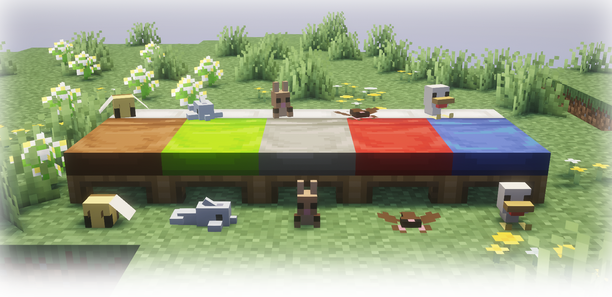

# Doudou

This is a Minecraft mod for version ~26.3 using Fabric >=0.19.5

## Usage

Doudous are craftable with basic materials.\
[_right-click_] on a bed to place them,\
[_SHIFT+right-click_] with an **empty hand** to retrieve them.

## Effects

Doudous have different effects when the player wakes up.\
(These effects may change in future updates.)

|**Doudou** |**Effect**     |
|-----------|---------------|
|Bat        |Night Vision   |
|Bee        |Haste          |
|Chicken    |Slow Falling   |
|Dolphin    |Water Breathing|
|Rabbit     |Jump Boost     |

## Config File

You can adjust the position and rotation of the doudou when it is placed on a bed via the mod's configuration file.

# Contribution

I am open to any suggestions or contributions.
